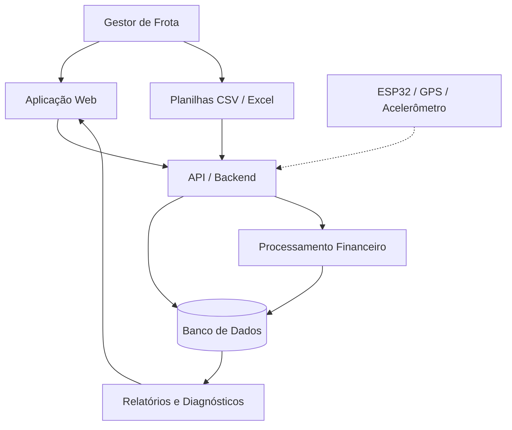

# Fleet Force — Cyber Security

## Sprint 1: Análise de Riscos e Modelagem de Ameaças

### Objetivo

Identificar e classificar os principais ativos, ameaças, vulnerabilidades e riscos de segurança da plataforma **Fleet Force**, propondo medidas iniciais de mitigação para proteger os dados e garantir a confiabilidade das análises financeiras.

Nesta sprint, o foco está no planejamento da segurança, utilizando a tríade **Confidencialidade, Integridade e Disponibilidade (CIA)** e a modelagem de ameaças.

---

## 1. Contexto do projeto

A Fleet Force é uma solução desenvolvida para o Challenge da Sem Parar Empresas, com o objetivo de transformar dados dispersos de uma frota em informações financeiras que auxiliem gestores na tomada de decisões.

A plataforma está estruturada em três funcionalidades principais:

- **Consolidação de custos:** importar planilhas CSV/Excel e organizar despesas com combustível, manutenção, pedágios, multas e outras categorias.
- **Benchmark financeiro:** comparar os custos identificados com referências para encontrar possíveis ineficiências.
- **Identificação de economias:** calcular oportunidades de redução de despesas e apresentar recomendações financeiras.

A solução também prevê a integração futura com dispositivos ESP32, GPS e acelerômetro para enriquecer as análises com informações operacionais.

Por trabalhar com informações financeiras, operacionais e potencialmente comerciais, a plataforma precisa garantir que os dados sejam acessados, processados e armazenados de maneira segura.

### Escopo da análise

A análise considera a arquitetura proposta da Fleet Force, incluindo componentes que ainda estão em desenvolvimento.

Os riscos apresentados representam **cenários possíveis de ameaça**, não vulnerabilidades comprovadas por testes de invasão.

---

## 2. Identificação e classificação dos ativos

Foram identificados 12 ativos relevantes para o funcionamento e a segurança da plataforma.

| Ativo | Tipo | Importância | Justificativa |
|---|---|---|---|
| Credenciais e sessões | Acesso | Crítica | Permitem acesso à plataforma e às informações protegidas. |
| Dados dos clientes | Dados | Crítica | Podem conter informações empresariais e pessoais protegidas. |
| Dados financeiros da frota | Financeiro | Crítica | Fundamentam os cálculos e decisões sobre os custos operacionais. |
| Planilhas importadas | Arquivo | Alta | São a principal fonte de entrada de informações financeiras. |
| Histórico de análises | Dados | Alta | Permite acompanhar a evolução das despesas e dos resultados. |
| Relatórios e diagnósticos | Documento | Alta | Contêm informações estratégicas e oportunidades de economia. |
| Aplicação Web | Software | Alta | Disponibiliza as funcionalidades e a interação com os usuários. |
| API e Backend | Software | Crítica | Executam validações, regras de negócio e processamento dos dados. |
| Banco de dados | Infraestrutura | Crítica | Armazena informações necessárias à operação da plataforma. |
| Dados de telemetria | Operacional | Alta | Podem conter localização e medições de veículos. |
| Logs e registros de auditoria | Segurança | Alta | Permitem investigar atividades suspeitas e incidentes. |
| Integrações e configurações | Infraestrutura | Alta | Incluem configurações, credenciais técnicas e serviços integrados. |

A classificação considera o impacto de acessos não autorizados, alterações indevidas ou indisponibilidade dos ativos.

---

## 3. Análise da Tríade CIA

A segurança da Fleet Force será analisada considerando três princípios.

**Confidencialidade:** impedir a visualização de informações por pessoas não autorizadas.

**Integridade:** garantir que informações financeiras, operacionais e resultados não sejam modificados indevidamente.

**Disponibilidade:** garantir que usuários autorizados consigam utilizar os serviços quando necessário.

### Aplicação aos ativos

Legenda: **C = Crítico | A = Alto | M = Médio**

| Ativo | Confidencialidade | Integridade | Disponibilidade |
|---|---|---|---|
| Credenciais e sessões | C | C | A |
| Dados dos clientes | C | C | A |
| Dados financeiros | C | C | A |
| Planilhas importadas | A | C | M |
| Histórico de análises | A | C | A |
| Relatórios e diagnósticos | A | C | M |
| Aplicação Web | M | A | A |
| API e Backend | A | C | C |
| Banco de dados | C | C | C |
| Dados de telemetria | A | A | M |
| Logs de auditoria | A | C | A |
| Integrações e configurações | C | C | A |

### Justificativas

**Confidencialidade:** gestores devem visualizar somente os dados das frotas às quais possuem autorização de acesso. Dados de outros clientes, credenciais e configurações internas não devem ser expostos.

**Integridade:** uma alteração indevida em despesas, quilômetros percorridos ou referências de comparação poderá produzir diagnósticos incorretos e comprometer as decisões financeiras.

**Disponibilidade:** a indisponibilidade da API ou do banco de dados poderá impedir a importação de planilhas, o processamento dos custos e a consulta aos relatórios.

Dessa forma, a integridade dos dados financeiros e a proteção do banco de dados estão entre as principais prioridades da solução.

---

## 4. Arquitetura e modelagem de ameaças

### 4.1 Arquitetura simplificada

A arquitetura representa o fluxo proposto para a plataforma, incluindo os componentes necessários ao processamento e armazenamento dos dados.

**Observação:** a integração com sensores representa uma funcionalidade prevista na evolução da plataforma, não uma dependência obrigatória para os cálculos financeiros iniciais.

### 4.2 Superfícies de ataque

Foram identificados seis pontos que exigem atenção:

1. **Aplicação Web:** possibilidade de XSS, roubo de sessão e manipulação de entradas.
2. **API:** possibilidade de acessos não autorizados, injeção de comandos e abuso de endpoints.
3. **Importação de planilhas:** possibilidade de envio de arquivos maliciosos, dados manipulados ou entradas inválidas.
4. **Banco de dados:** possibilidade de vazamento, alteração ou exclusão indevida de registros.
5. **Comunicação entre componentes:** possibilidade de interceptação ou manipulação de informações em trânsito.
6. **Dispositivos e integrações:** possibilidade de envio de dados falsificados ou uso indevido de credenciais técnicas.

### 4.3 Possíveis agentes de ameaça

| Agente | Motivação ou capacidade |
|---|---|
| Atacante externo | Explorar serviços públicos para obter informações ou interromper operações. |
| Usuário malicioso | Acessar ou modificar dados fora de suas permissões. |
| Colaborador com acesso legítimo | Utilizar indevidamente privilégios concedidos. |
| Atacante com credenciais comprometidas | Utilizar contas legítimas para acessar informações protegidas. |
| Origem de dados não confiável | Introduzir informações ou arquivos manipulados no processamento. |

---

## 5. Identificação de ameaças e vulnerabilidades

As principais ameaças foram relacionadas às possíveis fragilidades da arquitetura.

| Ameaça | Vulnerabilidade potencial | Consequência |
|---|---|---|
| Roubo de credenciais | Autenticação insuficiente ou exposição de tokens | Acesso indevido às contas |
| Força bruta | Ausência de limitação de tentativas | Comprometimento de contas |
| SQL Injection | Construção insegura de consultas | Leitura ou alteração de registros |
| XSS | Renderização insegura de conteúdo | Execução de scripts maliciosos |
| Acesso indevido à API | Falhas de autenticação ou autorização | Exposição de dados financeiros |
| Vazamento entre clientes | Ausência de isolamento por cliente | Acesso a informações de outras empresas |
| Manipulação de planilhas | Validação insuficiente de arquivos e campos | Alteração dos cálculos financeiros |
| Interceptação de dados | Comunicação sem proteção adequada | Exposição ou alteração de informações |
| Indisponibilidade | Falta de limites de requisição e recursos | Interrupção do serviço |
| Manipulação de telemetria | Ausência de autenticação da origem | Dados operacionais falsificados |
| Comprometimento do banco | Credenciais expostas ou privilégios excessivos | Vazamento, alteração ou perda de informações |
| Alteração de benchmarks | Ausência de validação e rastreabilidade das referências | Recomendações financeiras incorretas |

Esses cenários deverão ser validados nas próximas sprints por meio da implementação e dos testes dos controles de segurança.

---

## 6. Matriz de riscos

Para classificar os riscos, foram utilizados três níveis de probabilidade e impacto:

- **Baixo (1):** ocorrência pouco provável ou impacto limitado.
- **Médio (2):** ocorrência plausível ou impacto significativo.
- **Alto (3):** ocorrência provável ou impacto elevado.

A severidade é calculada por:

**Severidade = Probabilidade × Impacto**

| Pontuação | Severidade |
|---|---|
| 1–2 | Baixa |
| 3–4 | Média |
| 6 | Alta |
| 9 | Crítica |

As pontuações representam estimativas qualitativas iniciais, sujeitas a revisão após testes e levantamento dos controles existentes.

### Matriz de riscos identificados

| ID | Risco | Probabilidade | Impacto | Severidade | Mitigação proposta |
|---|---|---|---|---|---|
| R01 | Roubo de credenciais | Alta | Alto | Crítica | MFA e sessões seguras |
| R02 | Força bruta | Alta | Médio | Alta | Rate limiting e bloqueio progressivo |
| R03 | SQL Injection | Média | Alto | Alta | Consultas parametrizadas |
| R04 | XSS | Média | Alto | Alta | Sanitização contextual e CSP |
| R05 | Acesso indevido à API | Alta | Alto | Crítica | Autenticação e autorização por recurso |
| R06 | Vazamento de dados entre clientes | Média | Alto | Alta | Isolamento de dados por cliente |
| R07 | Manipulação de planilhas | Alta | Alto | Crítica | Validação de arquivos e dados |
| R08 | Interceptação de informações | Média | Alto | Alta | HTTPS/TLS |
| R09 | Indisponibilidade da API | Alta | Médio | Alta | Rate limiting e monitoramento |
| R10 | Falsificação de telemetria | Média | Médio | Média | Autenticação dos dispositivos e validação |
| R11 | Comprometimento do banco de dados | Média | Alto | Alta | Menor privilégio, criptografia e backups |
| R12 | Manipulação de referências financeiras | Média | Alto | Alta | Validação, versionamento e auditoria |

### Priorização

**Prioridade 1 — Riscos críticos**

- R01: Roubo de credenciais.
- R05: Acesso indevido à API.
- R07: Manipulação das planilhas importadas.

Esses riscos podem comprometer diretamente os dados dos clientes e a confiabilidade das informações financeiras da plataforma.

**Prioridade 2 — Riscos altos**

- R02, R03, R04, R06, R08, R09, R11 e R12.

Devem ser tratados durante a implementação da aplicação, principalmente nos mecanismos de validação, armazenamento, controle de acesso e comunicação.

**Prioridade 3 — Riscos médios**

- R10: Falsificação de dados de telemetria.

Deverá receber atenção conforme a integração com sensores evoluir, considerando que o diagnóstico financeiro inicial não depende obrigatoriamente desses dispositivos.

---

## 7. Propostas iniciais de mitigação

As medidas abaixo representam controles recomendados para as próximas etapas do projeto.

| Área | Medidas propostas |
|---|---|
| Autenticação | Senhas armazenadas com hash seguro, MFA e proteção contra força bruta. |
| Autorização | Controle de acesso por perfil e validação de permissões por recurso e cliente. |
| API | Validação de entradas, limites de requisição e tratamento seguro de erros. |
| Planilhas | Restrições de formato e tamanho, validação de conteúdo e rejeição de entradas inválidas. |
| Banco de dados | Consultas parametrizadas, menor privilégio, backups e proteção de credenciais. |
| Comunicação | HTTPS/TLS e proteção de tokens e sessões. |
| Relatórios | Controle de acesso, validação de resultados e rastreabilidade dos cálculos. |
| Telemetria | Identificação de dispositivos, validação das medições e proteção da comunicação. |
| Monitoramento | Logs estruturados, registros de auditoria e alertas para eventos suspeitos. |

### Estratégia de implementação

A segurança deverá ser incorporada progressivamente ao desenvolvimento da Fleet Force.

**Sprint 1 — Análise de riscos**

Identificação dos ativos, avaliação da tríade CIA, modelagem de ameaças e priorização das medidas de segurança.

**Sprint 2 — Implementação de controles**

Aplicação dos mecanismos de autenticação, autorização, validação de dados e proteção das comunicações.

**Sprint 3 — Validação de segurança**

Execução de testes para verificar a efetividade dos controles, incluindo tentativas de acesso indevido, manipulação de entradas e exploração de falhas.

**Sprint 4 — Monitoramento e resposta**

Implementação e avaliação de mecanismos para detectar atividades suspeitas, investigar incidentes e orientar ações de resposta.

---

## 8. Conclusão

A análise demonstrou que os principais riscos da Fleet Force estão relacionados à proteção das informações financeiras, ao controle de acesso e à integridade dos dados utilizados nos cálculos e diagnósticos.

A importação de planilhas merece atenção especial por representar uma das principais entradas de dados da plataforma. Informações incorretas ou manipuladas poderão comprometer diretamente a precisão das recomendações financeiras.

A arquitetura também deverá considerar a proteção da API, do banco de dados e das futuras integrações com sensores.

Com os 12 ativos identificados, a aplicação da tríade CIA, a modelagem da arquitetura e os 12 riscos classificados, esta primeira sprint estabelece a base para a implementação, validação e evolução da segurança da Fleet Force.
